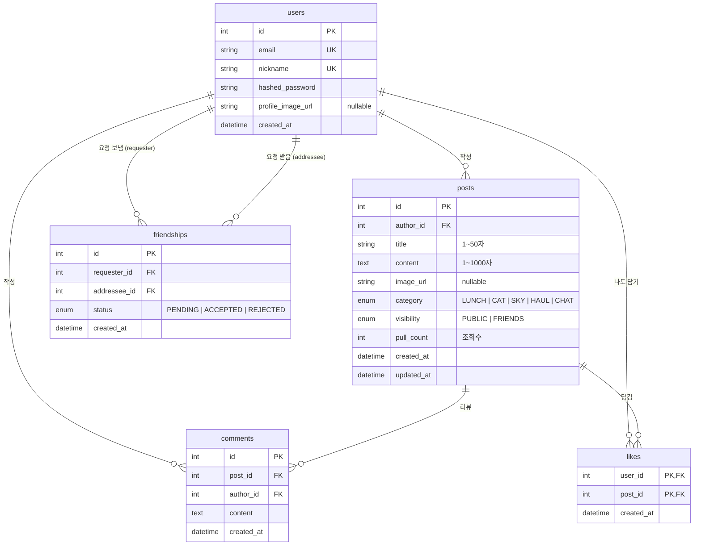

<a id="readme-top"></a>

<!-- PROJECT LOGO -->
<br />
<div align="center">
  <h1 align="center">🛒 What's in my cart?</h1>
  <!-- PROJECT SHIELDS -->
  <p align="center">
    
    
    
    
    
  </p>

  <p align="center">
    <b>오늘 뭐 담았어?</b> — 익명으로 걸고, 구경하는 오늘의 티켓
    <br />
    사진 한 장으로 오늘을 담아 티켓 레일에 거는 커뮤니티 게시판 API
    <br />
    <br />
    <a href="#api-명세"><strong>API 명세 보기 »</strong></a>
    <br />
    <br />
    <a href="http://3.25.130.252/web/"><strong>웹에서 써 보기 »</strong></a>
    &middot;
    <a href="http://3.25.130.252/docs">Swagger UI</a>
    &middot;
    <a href="https://github.com/mjlee0914/fastapi-board-api/issues">버그 제보</a>
  </p>
</div>

<!-- TABLE OF CONTENTS -->
<details>
  <summary>목차</summary>
  <ol>
    <li>
      <a href="#프로젝트-소개">프로젝트 소개</a>
      <ul>
        <li><a href="#시연">시연</a></li>
        <li><a href="#콘셉트">콘셉트</a></li>
        <li><a href="#익명성-원칙">익명성 원칙</a></li>
        <li><a href="#기술-스택">기술 스택</a></li>
      </ul>
    </li>
    <li>
      <a href="#시작하기">시작하기</a>
      <ul>
        <li><a href="#사전-준비">사전 준비</a></li>
        <li><a href="#설치-및-실행">설치 및 실행</a></li>
      </ul>
    </li>
    <li><a href="#사용법">사용법</a></li>
    <li><a href="#api-명세">API 명세</a></li>
    <li><a href="#데이터-모델">데이터 모델</a></li>
    <li><a href="#배포">배포</a></li>
    <li><a href="#프론트엔드">프론트엔드</a></li>
    <li><a href="#운영-기능">운영 기능</a></li>
    <li><a href="#테스트">테스트</a></li>
    <li><a href="#아키텍처">아키텍처</a></li>
    <li><a href="#로드맵">로드맵</a></li>
    <li><a href="#참고">참고</a></li>
  </ol>
</details>

<!-- ABOUT THE PROJECT -->

## 프로젝트 소개


> KANT AX Engineer 과정 CH 3 평가 과제 — **백엔드 아키텍처 & API 설계 (RESTful 게시판 API)**

친구들끼리 "오늘 뭐 먹었어?", "고양이 자랑" 같은 일상을 사진 한 장으로 공유하는 커뮤니티의 백엔드 API입니다.
마트 장바구니 콘셉트 위에, 주문을 받으면 티켓을 레일에 거는 **티켓 레일** 메커니즘을 얹었습니다.
백엔드와 같은 주소(`/web/`)에서 동작하는 웹 프론트엔드도 함께 제공합니다.

### 시연

<p align="center">
  
</p>

> 인트로 → 도시락을 빈 카트에 드래그 → 사진·제목·내용 입력 → 레일에 `#005` 티켓으로 걸림 → 고양이 티켓 조회와 익명 리뷰 → 영어 모드 전환

### 콘셉트

| 서비스에서   | 마트/주문 콘셉트로는                                                     | API                         |
| ------------ | ------------------------------------------------------------------------ | --------------------------- |
| 사진 글 쓰기 | 🎫 티켓을 레일에 **걸기**                                                | `POST /posts`               |
| 피드 보기    | 🧵 레일에 걸린 티켓들 (오늘의 전단지)                                    | `GET /posts`                |
| 글 상세 보기 | 👀 티켓을 눌러서 **조회**                                                | `GET /posts/{post_id}`      |
| 카테고리     | 🏪 마트 코너 (오늘 점심 / 고양이 자랑 / 오늘의 하늘 / 산 거 자랑 / 잡담) | `?category=`                |
| 내가 쓴 글   | 🛒 내 카트                                                               | `GET /users/me/posts`       |
| 댓글         | 📝 상품 리뷰                                                             | `/posts/{post_id}/comments` |
| 좋아요       | ➕ 나도 담기                                                             | `/posts/{post_id}/likes`    |

티켓에는 레일 감성을 살리는 정보가 함께 붙습니다.

- **주문 번호 `ticket_no`** — 그날 몇 번째로 걸린 티켓인지 (`#005`)
- **조회수 `pull_count`** — 다른 사람이 상세 조회할 때마다 +1 (작성자 본인 조회는 제외)
- **오늘의 레일** — `GET /posts?today=true`로 오늘 걸린 티켓만

### 익명성 원칙

로그인은 하지만, 다른 사람에게 보이는 정보는 최소화합니다.

- **전체 공개 글은 익명**, 친구 공개 글은 친구에게만 닉네임이 보입니다.
- **댓글은 글마다 익명 번호** — "글쓴이", "익명1", "익명2"… (같은 사람은 같은 번호)
- 응답에 다른 사용자의 `user_id`·`email`을 노출하지 않습니다. 내 글인지는 `is_mine`으로만 알려 줍니다.
- 수정·삭제 권한은 서버가 내부적으로 작성자를 확인합니다.
- 친구 요청은 닉네임으로 보냅니다.

### 기술 스택

| 분류      | 사용 기술                                                |
| --------- | -------------------------------------------------------- |
| Language  | Python 3.13                                              |
| Framework | FastAPI, Pydantic v2, pydantic-settings                  |
| Database  | PostgreSQL 16, SQLAlchemy 2.0 (async) + asyncpg, Alembic |
| Auth      | PyJWT (access token), bcrypt                             |
| Frontend  | HTML · CSS · JavaScript (빌드 없음), Gaegu 폰트, 손그림 SVG 아이콘, 한/영 모드 |
| Infra     | Docker Compose, AWS EC2 (Ubuntu), Nginx                  |
| Test      | pytest, httpx                                            |

<p align="right">(<a href="#readme-top">맨 위로</a>)</p>

<!-- GETTING STARTED -->

## 시작하기

### 사전 준비

- Python 3.11 이상
- Docker / Docker Compose
- (선택) [uv](https://github.com/astral-sh/uv) — 빠른 가상환경·패키지 설치

### 설치 및 실행

1. 저장소를 클론합니다.
   ```sh
   git clone https://github.com/mjlee0914/fastapi-board-api.git
   cd fastapi-board-api
   ```
2. 가상환경을 만들고 패키지를 설치합니다.
   ```sh
   uv venv .venv && source .venv/bin/activate
   uv pip install -r requirements.txt
   ```
3. 환경변수 파일을 만들고 `SECRET_KEY`를 랜덤 값으로 바꿉니다.
   ```sh
   cp .env.example .env
   python -c "import secrets; print(secrets.token_urlsafe(48))"
   ```
4. PostgreSQL을 실행합니다. (로컬 포트 `5433`)
   ```sh
   docker compose up -d
   ```
5. DB 테이블을 만듭니다.
   ```sh
   alembic upgrade head
   ```
6. 서버를 실행합니다.
   ```sh
   uvicorn app.main:app --reload
   ```
7. http://localhost:8000/health 에서 `{"status":"ok","db":"ok"}`가 나오면 준비 완료입니다.

<p align="right">(<a href="#readme-top">맨 위로</a>)</p>

<!-- USAGE -->

## 사용법

Swagger UI(`/docs`)에서 모든 API를 직접 실행해 볼 수 있습니다.

1. `POST /auth/signup`으로 가입합니다.
2. `POST /auth/login`으로 로그인하고 응답의 `access_token`을 복사합니다.
3. 우측 상단 **Authorize** 버튼에 토큰을 붙여넣습니다.
4. 로그인이 필요한 API를 호출합니다.

```sh
# 로그인
curl -X POST http://localhost:8000/auth/login \
  -H "Content-Type: application/json" \
  -d '{"email": "jiwoo@example.com", "password": "password123"}'

# 사진과 함께 티켓 걸기 (multipart/form-data)
curl -X POST http://localhost:8000/posts \
  -H "Authorization: Bearer <access_token>" \
  -F "title=오늘 점심" -F "content=김치찌개" -F "category=LUNCH" -F "visibility=PUBLIC" \
  -F "image=@lunch.jpg;type=image/jpeg"
```

업로드한 사진은 응답의 `image_url`(예: `/uploads/3f2a....jpg`)로 바로 볼 수 있습니다.

<p align="right">(<a href="#readme-top">맨 위로</a>)</p>

<!-- API -->

## API 명세

| 태그     | 기능                           | 메서드 · 경로                                                  | 권한                  |
| -------- | ------------------------------ | -------------------------------------------------------------- | --------------------- |
| Health   | 서버·DB 상태 확인              | `GET /health`                                                  | 누구나                |
| Auth     | 회원가입                       | `POST /auth/signup`                                            | 누구나                |
| Auth     | 로그인 (JWT 발급)              | `POST /auth/login`                                             | 누구나                |
| Users    | 내 정보                        | `GET /users/me`                                                | 로그인                |
| Users    | 내 카트 (내가 쓴 글)           | `GET /users/me/posts`                                          | 로그인                |
| Posts    | 피드 (티켓 레일)               | `GET /posts?category=&sort=latest\|popular&today=&page=&size=` | 비회원 허용           |
| Posts    | 글 상세 조회                   | `GET /posts/{post_id}`                                         | 공개 범위에 따라      |
| Posts    | 글 작성 (사진 포함, multipart) | `POST /posts`                                                  | 로그인                |
| Posts    | 글 수정                        | `PATCH /posts/{post_id}`                                       | 작성자만              |
| Posts    | 글 삭제                        | `DELETE /posts/{post_id}`                                      | 작성자만              |
| Comments | 댓글 목록                      | `GET /posts/{post_id}/comments`                                | 글을 볼 수 있는 사람  |
| Comments | 댓글 작성                      | `POST /posts/{post_id}/comments`                               | 로그인 + 글 열람 가능 |
| Comments | 댓글 삭제                      | `DELETE /comments/{comment_id}`                                | 댓글 작성자만         |
| Likes    | 나도 담기                      | `POST /posts/{post_id}/likes`                                  | 로그인                |
| Likes    | 담기 취소                      | `DELETE /posts/{post_id}/likes`                                | 로그인                |
| Friends  | 친구 요청 (닉네임)             | `POST /friends/requests`                                       | 로그인                |
| Friends  | 받은/보낸 요청 목록            | `GET /friends/requests?type=received\|sent`                    | 로그인                |
| Friends  | 요청 수락·거절                 | `PATCH /friends/requests/{request_id}`                         | 받은 사람만           |
| Friends  | 친구 목록                      | `GET /friends`                                                 | 로그인                |
| Friends  | 친구 삭제                      | `DELETE /friends/{nickname}`                                   | 로그인                |

### 공개 범위 규칙

| 사용자      | 볼 수 있는 글                                              |
| ----------- | ---------------------------------------------------------- |
| 비회원      | `PUBLIC` 글만                                              |
| 로그인 회원 | `PUBLIC` 글 + 친구(`ACCEPTED`)의 `FRIENDS` 글 + 내 글 전부 |

볼 권한이 없는 `FRIENDS` 글은 존재 자체를 숨기기 위해 `404`로 응답합니다.

### 응답 규칙

- 상태 코드: 생성 `201`, 삭제 `204`, 조회·수정 `200`
- 목록 응답: `{ "items": [...], "page": 1, "size": 20, "total": 123 }`
- 에러 응답 (모든 에러 동일 형태):
  ```json
  {
    "error": {
      "code": "POST_NOT_FOUND",
      "message": "게시글을 찾을 수 없습니다.",
      "details": null
    }
  }
  ```

| 상태 | 대표 코드                                                                           |
| ---- | ----------------------------------------------------------------------------------- |
| 400  | `CANNOT_FRIEND_SELF`, `INVALID_IMAGE`                                               |
| 401  | `UNAUTHORIZED`, `TOKEN_EXPIRED`                                                     |
| 403  | `FORBIDDEN`                                                                         |
| 404  | `POST_NOT_FOUND`, `COMMENT_NOT_FOUND`                                               |
| 409  | `EMAIL_ALREADY_EXISTS`, `ALREADY_LIKED`, `ALREADY_FRIENDS`, `FRIEND_REQUEST_EXISTS` |
| 422  | `VALIDATION_ERROR` (`details`에 필드별 오류)                                        |

<p align="right">(<a href="#readme-top">맨 위로</a>)</p>

<!-- DATA MODEL -->

## 데이터 모델



- **likes**: `(user_id, post_id)` 복합 PK로 같은 글 중복 좋아요를 DB에서 막습니다.
- **friendships**: User 자기참조 N:M. 자기 자신에게 요청 금지(CHECK), A→B·B→A 중복 요청 금지(unique).
- 글 삭제 시 댓글·좋아요는 함께 삭제됩니다(cascade).
- ERDCloud import용 DDL: [`docs/erd.sql`](docs/erd.sql)

<p align="right">(<a href="#readme-top">맨 위로</a>)</p>

<!-- DEPLOYMENT -->

## 배포

| 항목 | 주소 |
| --- | --- |
| 웹 프론트엔드 | http://3.25.130.252/web/ |
| Swagger UI | http://3.25.130.252/docs |
| OpenAPI JSON | http://3.25.130.252/openapi.json |
| 헬스 체크 | http://3.25.130.252/health |

```
브라우저 ──(80)──▶ [AWS EC2 · Ubuntu 24.04]
                   ├─ nginx   리버스 프록시 (외부에 열린 포트는 80 하나)
                   ├─ app     FastAPI + uvicorn (시작할 때 alembic upgrade head 자동 실행)
                   └─ db      PostgreSQL 16 (외부 비공개, 데이터는 Docker 볼륨에 보존)
```

- 보안 그룹: HTTP 80은 전체 공개, SSH 22는 관리자 IP만 허용. 8000·5432는 외부에 열지 않음
- 비밀값(DB 비밀번호, `SECRET_KEY`)은 서버의 `.env.prod`에만 두고 Git·이미지에 포함하지 않음
- nginx `client_max_body_size 6M`으로 5MB 사진 업로드 허용

서버에서 실행·업데이트하는 방법:

```sh
git clone https://github.com/mjlee0914/fastapi-board-api.git && cd fastapi-board-api
cp .env.prod.example .env.prod   # 비밀번호와 SECRET_KEY를 랜덤 값으로 변경
docker compose -f docker-compose.prod.yml --env-file .env.prod up -d --build

# 코드 업데이트
git pull && docker compose -f docker-compose.prod.yml --env-file .env.prod up -d --build
```

<p align="right">(<a href="#readme-top">맨 위로</a>)</p>

<!-- FRONTEND -->

## 프론트엔드

빌드 없이 쓰는 HTML/CSS/JS(`frontend/`)를 FastAPI가 `/web/`에서 같이 서빙합니다. API와 같은 주소라서 CORS 설정 없이 동작하고, 주소만 입력하면(`/`) `/web/`으로 이동합니다.

| 화면 | 주소 | 내용 |
| --- | --- | --- |
| 인트로 | 첫 접속 | `WHAT'S IN MY CART?` 손글씨 문구가 카트 속으로 쏙 들어가는 애니메이션 |
| 담기 (홈) | `/web/#/home` | 손그림 상품(도시락, 고양이 캔, 구름 포장, 쇼핑백, 탄산 캔)을 빈 카트에 드래그(모바일은 탭)해서 글쓰기 시작 |
| 카트에 담기 | `/web/#/hang` | 고른 상품의 코너로 시작, 코너별 제목·내용 예시 문구, 사진 미리보기, 공개 범위 선택 |
| 오늘의 레일 | `/web/#/rail` | 레일에 빨간 집게로 걸린 영수증 티켓. 카테고리·최신/인기순·오늘만 필터, 가로 스크롤 |
| 티켓 상세 | `/web/#/ticket/{id}` | 영수증 형태의 상세. 조회수, 나도 담기, 익명 리뷰(글쓴이·익명1…), 수정·삭제 |
| 내 카트 | `/web/#/cart` | 내 티켓과 영수증 형태의 합계 (조회수, 담기 수) |
| 친구 | `/web/#/friends` | 닉네임으로 요청, 받은 요청 수락·거절, 친구 삭제 |

### 디자인

- 흰 배경, 짙은 회색(`#3f3f3f`) 손글씨 폰트 **Gaegu**로 통일하고 빨간색은 선택 밑줄·하트·집게 같은 포인트에만 사용
- 레일: 연필로 그린 쇠막대에 **빨간 바인더 집게**(SVG)로 영수증 티켓이 매달리고, 마우스를 올리면 집게를 축으로 흔들림
- 담기 수는 사진 모서리의 **하트 스티커**. 내가 담은 티켓은 하트가 빨갛게 채워짐
- 카테고리 아이콘은 홈의 손그림 상품을 작게 줄여 사용(원본 약 2MB → 아이콘 약 20KB), 그 밖의 아이콘은 손그림 선 SVG

### 한/영 모드

- 상단 메뉴의 지구본 탭으로 **한국어 ↔ English** 전환. 선택한 언어는 브라우저에 기억하고, 처음 방문하면 브라우저 언어를 따라감
- 화면 문구는 `frontend/app.js`의 `I18N` 사전 한 곳에서 관리
- 서버 에러 메시지는 한국어지만, 영어 모드에서는 **표준 에러 코드**(`POST_NOT_FOUND` 등)로 영어 문장을 찾아 보여 줌

### 보안

- 사용자가 쓴 글은 모두 escape해서 넣어 XSS를 막음
- 토큰이 만료되면(`TOKEN_EXPIRED`) 자동으로 로그아웃하고 로그인 화면으로 이동

<p align="right">(<a href="#readme-top">맨 위로</a>)</p>

<!-- OPERATIONS -->

## 운영 기능

| 기능          | 구현                                                                                                     | 확인 방법                                                    |
| ------------- | -------------------------------------------------------------------------------------------------------- | ------------------------------------------------------------ |
| 비동기        | FastAPI + SQLAlchemy 2.0 async + asyncpg                                                                 | 모든 DB 작업이 `await`                                       |
| 이미지 업로드 | jpg/png/webp, 5MB 이하. content-type과 파일 시그니처(매직 넘버) 둘 다 검사, 파일명은 UUID로 재생성       | `INVALID_IMAGE` 400                                          |
| 저장소 분리   | `ImageStorage` 인터페이스 + `LocalImageStorage` → S3로 교체 가능                                         | `app/storage/`                                               |
| 캐싱          | 비회원 피드를 TTL(30초) 인메모리 캐시. 글·댓글·좋아요 변경 시 비움. `Cache` 인터페이스로 Redis 교체 가능 | 응답 헤더 `X-Cache: HIT \| MISS`                             |
| 미들웨어      | 요청 로깅(메서드, 경로, 상태, 처리 시간), CORS                                                           | 응답 헤더 `X-Process-Time`                                   |
| 예외 처리     | 커스텀 예외 + 전역 핸들러 4종. 500은 로그에만 상세 기록, 응답에는 내부 정보 노출 x                       | 모든 에러가 같은 `{"error": ...}` 형태                       |
| N+1 방지      | 좋아요·댓글 수·주문 번호는 상관 서브쿼리로 한 번에, 작성자·친구 정보는 `selectinload`                    | `test_feed_has_no_n_plus_1` (글 2개와 10개의 쿼리 수가 같음) |
| 동시성        | `pull_count`는 DB에서 `+1` 계산, 좋아요 중복은 복합 PK + `IntegrityError` 처리                           |                                                              |

<p align="right">(<a href="#readme-top">맨 위로</a>)</p>

<!-- TESTS -->

## 테스트

권한 시나리오 위주로 21개 테스트를 작성했습니다. 개발 DB와 분리된 테스트 전용 DB(`board_test`)를 자동으로 만들어 사용합니다.

```sh
docker compose up -d   # PostgreSQL이 켜져 있어야 함
pytest -q
```

| 파일                   | 검증하는 것                                                                                                                              |
| ---------------------- | ---------------------------------------------------------------------------------------------------------------------------------------- |
| `tests/test_auth.py`   | 가입·로그인, 중복 이메일 409, 검증 에러 형식, 토큰 없음·만료·위조 401, 응답에 비밀번호 해시 없음                                         |
| `tests/test_posts.py`  | 작성자만 수정·삭제(403), 이미지 업로드·위장 파일 거절, 익명 작성자, `pull_count`·`ticket_no`, 페이지네이션·정렬·필터, 캐시 HIT/MISS, N+1 |
| `tests/test_social.py` | FRIENDS 글 공개 범위(404로 숨김), 친구 요청 규칙, 댓글 익명 번호, 좋아요 1회, 글 삭제 시 CASCADE                                         |

<p align="right">(<a href="#readme-top">맨 위로</a>)</p>

<!-- ARCHITECTURE -->

## 아키텍처

```
요청 → 미들웨어 → api/routes (라우터) → services (비즈니스 로직) → models / storage (DB, 파일)
```

| 계층   | 위치                                     | 역할                                                             |
| ------ | ---------------------------------------- | ---------------------------------------------------------------- |
| 라우터 | `app/api/routes/`, `app/schemas/`        | 요청 받기, Pydantic 검증, 응답 만들기. **DB를 직접 다루지 않음** |
| 서비스 | `app/services/`                          | 권한 체크, 공개 범위 판단, 조회 → 저장 → commit 흐름             |
| 데이터 | `app/models/`, `app/db/`, `app/storage/` | SQLAlchemy 모델, 세션 관리, 이미지 파일 저장                     |

```
app/
├── main.py            # 앱 생성, 라우터·미들웨어·예외 핸들러 등록, /health
├── core/              # config(.env), security(해싱·JWT), exceptions, error_handlers, middleware, cache
├── db/                # Base, async engine, get_db
├── models/            # User, Post, Comment, Like, Friendship
├── schemas/           # Pydantic 요청/응답 스키마
├── services/          # 비즈니스 로직
├── api/               # deps(get_current_user / get_optional_user), routes
└── storage/           # 이미지 저장 (로컬 → S3 확장 가능)
tests/                 # pytest 권한 시나리오 테스트
```

<p align="right">(<a href="#readme-top">맨 위로</a>)</p>

<!-- ROADMAP -->

## 로드맵

- [x] 프로젝트 세팅 — 패키지, docker-compose(PostgreSQL), 설정, DB 연결, `/health`
- [x] 모델 + Alembic 마이그레이션
- [x] 인증 — 회원가입, 로그인, JWT, bcrypt, 토큰 만료
- [x] 에러 스키마 — 커스텀 예외 + 전역 핸들러
- [x] 게시글 CRUD + 이미지 업로드 (jpg/png/webp, 5MB 이하)
- [x] 댓글 + 좋아요 (익명 번호)
- [x] 친구 기능 + 공개 범위 필터
- [x] 미들웨어(CORS, 요청 로깅, `X-Process-Time`) + 피드 캐싱 + N+1 점검
- [x] 권한 시나리오 테스트
- [x] AWS EC2 배포 (Docker Compose + Nginx)
- [x] 웹 프론트엔드 (`/web/`) — 카트에 담기, 티켓 레일, 하트 담기, 한/영 모드

**나중에**

- [ ] 날짜별 레일 보기 — `GET /posts?date=YYYY-MM-DD` (KST 하루 단위) + 날짜 넘기기
- [ ] 실시간 알림 (SSE/WebSocket) — "누군가 방금 점심을 담았어요"
- [ ] 체크아웃 영수증 — 오늘 활동을 영수증으로 저장·공유
- [ ] 누가 내 티켓을 조회했는지 기록
- [ ] S3 이미지 저장, Redis 캐시

<p align="right">(<a href="#readme-top">맨 위로</a>)</p>

<!-- ACKNOWLEDGMENTS -->

## 참고

- [Best-README-Template](https://github.com/othneildrew/Best-README-Template)
- [FastAPI 공식 문서](https://fastapi.tiangolo.com/)
- [SQLAlchemy 2.0 문서](https://docs.sqlalchemy.org/en/20/)
- [Shields.io](https://shields.io)

<p align="right">(<a href="#readme-top">맨 위로</a>)</p>
