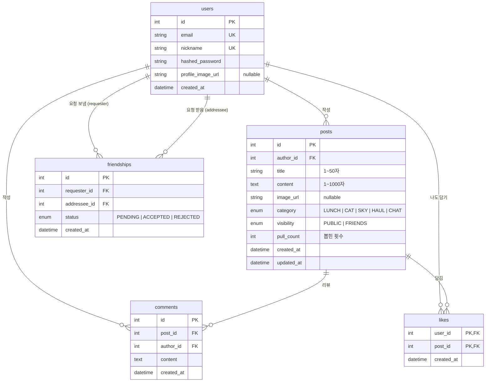

<a id="readme-top"></a>

<!-- PROJECT SHIELDS -->


<!-- PROJECT LOGO -->
<br />
<div align="center">
  <h1 align="center">🛒 What's in my cart?</h1>

  <p align="center">
    <b>오늘 뭐 담았어?</b> — 익명으로 걸고, 뽑아 보는 오늘의 티켓
    <br />
    사진 한 장으로 오늘을 담아 티켓 레일에 거는 커뮤니티 게시판 API
    <br />
    <br />
    <a href="#api-명세"><strong>API 명세 보기 »</strong></a>
    <br />
    <br />
    <a href="http://<EC2-IP>/docs">Swagger UI (배포 예정)</a>
    &middot;
    <a href="https://github.com/mjlee0914/fastapi-board-api/issues">버그 제보</a>
  </p>
</div>

<!-- TABLE OF CONTENTS -->
<details>
  <summary>목차</summary>
  <ol>
    <li>
      <a href="#프로젝트-소개">프로젝트 소개</a>
      <ul>
        <li><a href="#콘셉트">콘셉트</a></li>
        <li><a href="#익명성-원칙">익명성 원칙</a></li>
        <li><a href="#기술-스택">기술 스택</a></li>
      </ul>
    </li>
    <li>
      <a href="#시작하기">시작하기</a>
      <ul>
        <li><a href="#사전-준비">사전 준비</a></li>
        <li><a href="#설치-및-실행">설치 및 실행</a></li>
      </ul>
    </li>
    <li><a href="#사용법">사용법</a></li>
    <li><a href="#api-명세">API 명세</a></li>
    <li><a href="#데이터-모델">데이터 모델</a></li>
    <li><a href="#아키텍처">아키텍처</a></li>
    <li><a href="#로드맵">로드맵</a></li>
    <li><a href="#연락처">연락처</a></li>
    <li><a href="#참고">참고</a></li>
  </ol>
</details>

<!-- ABOUT THE PROJECT -->
## 프로젝트 소개

> KANT AX Engineer 과정 평가 과제 — **백엔드 아키텍처 & API 설계 (RESTful 게시판 API)**

친구들끼리 "오늘 뭐 먹었어?", "고양이 자랑" 같은 일상을 사진 한 장으로 공유하는 커뮤니티의 백엔드 API입니다.
마트 장바구니 콘셉트 위에, 주문을 받으면 티켓을 레일에 거는 **티켓 레일** 메커니즘을 얹었습니다.

### 콘셉트

| 서비스에서 | 마트/주문 콘셉트로는 | API |
|---|---|---|
| 사진 글 쓰기 | 🎫 티켓을 레일에 **걸기** | `POST /posts` |
| 피드 보기 | 🧵 레일에 걸린 티켓들 (오늘의 전단지) | `GET /posts` |
| 글 상세 보기 | ✋ 티켓을 **뽑아서** 보기 | `GET /posts/{post_id}` |
| 카테고리 | 🏪 마트 코너 (오늘 점심 / 고양이 자랑 / 오늘의 하늘 / 산 거 자랑 / 잡담) | `?category=` |
| 내가 쓴 글 | 🛒 내 카트 | `GET /users/me/posts` |
| 댓글 | 📝 상품 리뷰 | `/posts/{post_id}/comments` |
| 좋아요 | ➕ 나도 담기 | `/posts/{post_id}/likes` |

티켓에는 레일 감성을 살리는 정보가 함께 붙습니다.

- **주문 번호 `ticket_no`** — 그날 몇 번째로 걸린 티켓인지 (`#005`)
- **뽑힌 횟수 `pull_count`** — 티켓이 몇 번 뽑혔는지 (상세 조회 시 +1)
- **오늘의 레일** — `GET /posts?today=true`로 오늘 걸린 티켓만

### 익명성 원칙

로그인은 하지만, 다른 사람에게 보이는 정보는 최소화합니다.

- **전체 공개 글은 익명**, 친구 공개 글은 친구에게만 닉네임이 보입니다.
- **댓글은 글마다 익명 번호** — "글쓴이", "익명1", "익명2"… (같은 사람은 같은 번호)
- 응답에 다른 사용자의 `user_id`·`email`을 노출하지 않습니다. 내 글인지는 `is_mine`으로만 알려 줍니다.
- 수정·삭제 권한은 서버가 내부적으로 작성자를 확인합니다.
- 친구 요청은 닉네임으로 보냅니다.

### 기술 스택

| 분류 | 사용 기술 |
|---|---|
| Language | Python 3.13 |
| Framework | FastAPI, Pydantic v2, pydantic-settings |
| Database | PostgreSQL 16, SQLAlchemy 2.0 (async) + asyncpg, Alembic |
| Auth | PyJWT (access token), bcrypt |
| Infra | Docker Compose, AWS EC2 (Ubuntu), Nginx |
| Test | pytest, httpx |

<p align="right">(<a href="#readme-top">맨 위로</a>)</p>

<!-- GETTING STARTED -->
## 시작하기

### 사전 준비

- Python 3.11 이상
- Docker / Docker Compose
- (선택) [uv](https://github.com/astral-sh/uv) — 빠른 가상환경·패키지 설치

### 설치 및 실행

1. 저장소를 클론합니다.
   ```sh
   git clone https://github.com/mjlee0914/fastapi-board-api.git
   cd fastapi-board-api
   ```
2. 가상환경을 만들고 패키지를 설치합니다.
   ```sh
   uv venv .venv && source .venv/bin/activate
   uv pip install -r requirements.txt
   ```
3. 환경변수 파일을 만들고 `SECRET_KEY`를 랜덤 값으로 바꿉니다.
   ```sh
   cp .env.example .env
   python -c "import secrets; print(secrets.token_urlsafe(48))"
   ```
4. PostgreSQL을 실행합니다. (로컬 포트 `5433`)
   ```sh
   docker compose up -d
   ```
5. DB 테이블을 만듭니다.
   ```sh
   alembic upgrade head
   ```
6. 서버를 실행합니다.
   ```sh
   uvicorn app.main:app --reload
   ```
7. http://localhost:8000/health 에서 `{"status":"ok","db":"ok"}`가 나오면 준비 완료입니다.

<p align="right">(<a href="#readme-top">맨 위로</a>)</p>

<!-- USAGE -->
## 사용법

Swagger UI(`/docs`)에서 모든 API를 직접 실행해 볼 수 있습니다.

1. `POST /auth/signup`으로 가입합니다.
2. `POST /auth/login`으로 로그인하고 응답의 `access_token`을 복사합니다.
3. 우측 상단 **Authorize** 버튼에 토큰을 붙여넣습니다.
4. 로그인이 필요한 API를 호출합니다.

```sh
curl -X POST http://localhost:8000/auth/login \
  -H "Content-Type: application/json" \
  -d '{"email": "jiwoo@example.com", "password": "password123"}'
```

<p align="right">(<a href="#readme-top">맨 위로</a>)</p>

<!-- API -->
## API 명세

| 태그 | 기능 | 메서드 · 경로 | 권한 |
|---|---|---|---|
| Health | 서버·DB 상태 확인 | `GET /health` | 누구나 |
| Auth | 회원가입 | `POST /auth/signup` | 누구나 |
| Auth | 로그인 (JWT 발급) | `POST /auth/login` | 누구나 |
| Users | 내 정보 | `GET /users/me` | 로그인 |
| Users | 내 카트 (내가 쓴 글) | `GET /users/me/posts` | 로그인 |
| Posts | 피드 (티켓 레일) | `GET /posts?category=&sort=latest\|popular&today=&page=&size=` | 비회원 허용 |
| Posts | 글 상세 (티켓 뽑기) | `GET /posts/{post_id}` | 공개 범위에 따라 |
| Posts | 글 작성 (사진 포함, multipart) | `POST /posts` | 로그인 |
| Posts | 글 수정 | `PATCH /posts/{post_id}` | 작성자만 |
| Posts | 글 삭제 | `DELETE /posts/{post_id}` | 작성자만 |
| Comments | 댓글 목록 | `GET /posts/{post_id}/comments` | 글을 볼 수 있는 사람 |
| Comments | 댓글 작성 | `POST /posts/{post_id}/comments` | 로그인 + 글 열람 가능 |
| Comments | 댓글 삭제 | `DELETE /comments/{comment_id}` | 댓글 작성자만 |
| Likes | 나도 담기 | `POST /posts/{post_id}/likes` | 로그인 |
| Likes | 담기 취소 | `DELETE /posts/{post_id}/likes` | 로그인 |
| Friends | 친구 요청 (닉네임) | `POST /friends/requests` | 로그인 |
| Friends | 받은/보낸 요청 목록 | `GET /friends/requests?type=received\|sent` | 로그인 |
| Friends | 요청 수락·거절 | `PATCH /friends/requests/{request_id}` | 받은 사람만 |
| Friends | 친구 목록 | `GET /friends` | 로그인 |
| Friends | 친구 삭제 | `DELETE /friends/{user_id}` | 로그인 |

### 공개 범위 규칙

| 사용자 | 볼 수 있는 글 |
|---|---|
| 비회원 | `PUBLIC` 글만 |
| 로그인 회원 | `PUBLIC` 글 + 친구(`ACCEPTED`)의 `FRIENDS` 글 + 내 글 전부 |

볼 권한이 없는 `FRIENDS` 글은 존재 자체를 숨기기 위해 `404`로 응답합니다.

### 응답 규칙

- 상태 코드: 생성 `201`, 삭제 `204`, 조회·수정 `200`
- 목록 응답: `{ "items": [...], "page": 1, "size": 20, "total": 123 }`
- 에러 응답 (모든 에러 동일 형태):
  ```json
  {
    "error": {
      "code": "POST_NOT_FOUND",
      "message": "게시글을 찾을 수 없습니다.",
      "details": null
    }
  }
  ```

| 상태 | 대표 코드 |
|---|---|
| 400 | `CANNOT_FRIEND_SELF`, `INVALID_IMAGE` |
| 401 | `UNAUTHORIZED`, `TOKEN_EXPIRED` |
| 403 | `FORBIDDEN` |
| 404 | `POST_NOT_FOUND`, `COMMENT_NOT_FOUND` |
| 409 | `EMAIL_ALREADY_EXISTS`, `ALREADY_LIKED`, `ALREADY_FRIENDS`, `FRIEND_REQUEST_EXISTS` |
| 422 | `VALIDATION_ERROR` (`details`에 필드별 오류) |

<p align="right">(<a href="#readme-top">맨 위로</a>)</p>

<!-- DATA MODEL -->
## 데이터 모델



- **likes**: `(user_id, post_id)` 복합 PK로 같은 글 중복 좋아요를 DB에서 막습니다.
- **friendships**: User 자기참조 N:M. 자기 자신에게 요청 금지(CHECK), A→B·B→A 중복 요청 금지(unique).
- 글 삭제 시 댓글·좋아요는 함께 삭제됩니다(cascade).
- ERDCloud import용 DDL: [`docs/erd.sql`](docs/erd.sql)

<p align="right">(<a href="#readme-top">맨 위로</a>)</p>

<!-- ARCHITECTURE -->
## 아키텍처

```
요청 → api/routes (라우터) → services (비즈니스 로직) → models / repositories (DB)
```

| 계층 | 위치 | 역할 |
|---|---|---|
| 라우터 | `app/api/routes/`, `app/schemas/` | 요청 받기, Pydantic 검증, 응답 만들기. **DB를 직접 다루지 않음** |
| 서비스 | `app/services/` | 권한 체크, 공개 범위 판단, 조회 → 저장 → commit 흐름 |
| 데이터 | `app/models/`, `app/repositories/`, `app/db/` | SQLAlchemy 모델, DB 조회·저장, 세션 관리 |

```
app/
├── main.py            # 앱 생성, 라우터·미들웨어·예외 핸들러 등록, /health
├── core/              # config(.env), security(해싱·JWT), exceptions, cache
├── db/                # Base, async engine, get_db
├── models/            # User, Post, Comment, Like, Friendship
├── schemas/           # Pydantic 요청/응답 스키마
├── services/          # 비즈니스 로직
├── repositories/      # DB 쿼리
├── api/               # deps(get_current_user / get_optional_user), routes
└── storage/           # 이미지 저장 (로컬 → S3 확장 가능)
```

<p align="right">(<a href="#readme-top">맨 위로</a>)</p>

<!-- ROADMAP -->
## 로드맵

- [x] 프로젝트 세팅 — 패키지, docker-compose(PostgreSQL), 설정, DB 연결, `/health`
- [ ] 모델 + Alembic 마이그레이션
- [ ] 인증 — 회원가입, 로그인, JWT, bcrypt, 토큰 만료
- [ ] 에러 스키마 — 커스텀 예외 + 전역 핸들러
- [ ] 게시글 CRUD + 이미지 업로드 (jpg/png/webp, 5MB 이하)
- [ ] 댓글 + 좋아요 (익명 번호)
- [ ] 친구 기능 + 공개 범위 필터
- [ ] 미들웨어(CORS, 요청 로깅, `X-Process-Time`) + 피드 캐싱 + N+1 점검
- [ ] 권한 시나리오 테스트
- [ ] AWS EC2 배포 (Docker Compose + Nginx)

**나중에**

- [ ] 실시간 알림 (SSE/WebSocket) — "누군가 방금 점심을 담았어요"
- [ ] 체크아웃 영수증 — 오늘 활동을 영수증으로 저장·공유
- [ ] 누가 내 티켓을 뽑았는지 기록
- [ ] S3 이미지 저장, Redis 캐시
- [ ] 프론트엔드 — B급 키치 콜라주 + 영수증 감성

<p align="right">(<a href="#readme-top">맨 위로</a>)</p>

<!-- CONTACT -->
## 연락처

GitHub: [@mjlee0914](https://github.com/mjlee0914)

프로젝트 링크: [https://github.com/mjlee0914/fastapi-board-api](https://github.com/mjlee0914/fastapi-board-api)

<p align="right">(<a href="#readme-top">맨 위로</a>)</p>

<!-- ACKNOWLEDGMENTS -->
## 참고

- [Best-README-Template](https://github.com/othneildrew/Best-README-Template)
- [FastAPI 공식 문서](https://fastapi.tiangolo.com/)
- [SQLAlchemy 2.0 문서](https://docs.sqlalchemy.org/en/20/)
- [Shields.io](https://shields.io)

<p align="right">(<a href="#readme-top">맨 위로</a>)</p>
